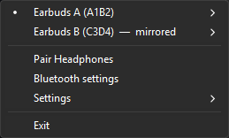
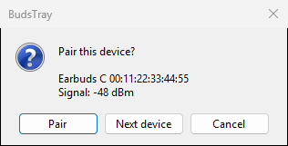
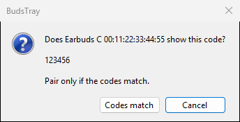

# BudsTray

A Windows tray app that switches between Bluetooth headphones with one click, shows their
battery in the tray icon, and can play to two sets at once.

It is useful if you own more than one set of earbuds or headphones: for example, two
identical pairs you swap when one runs low, or one pair for calls and one for music.

## Screenshots

| Tray menu | Pairing a device | Pairing code check |
| --- | --- | --- |
|  |  |  |

The screenshots use the built-in demo mode with made-up devices.

## Features

- **One-click switching.** Click a set in the tray menu to play to it. BudsTray connects it
  if needed and makes it the Windows default output.
- **Automatic handover.** When the set you are listening to disconnects (for example, you
  put it back in its case) and another set is still connected, the other set becomes the
  output right away instead of Windows falling back to the speakers. A set that connects
  while no other set is connected also becomes the output.
- **Mirror audio (optional, off by default).** While two sets are connected, the set
  Windows plays to is copied to the other one, so the second set is already playing when
  you take it out. See [Limitations](#limitations-and-known-issues).
- **Keep volume.** Windows keeps a separate volume per device; BudsTray carries the volume
  over to the set you switch to.
- **Battery in the tray icon.** The battery level of the set Windows plays to (or of the
  connected set), drawn as a number in the icon (red at 20% and below) and shown in the
  tooltip.
- **Disable microphone** per set. Turns off the set's Hands-Free endpoints so apps cannot
  use its microphone (or switch it into the lower-quality headset mode). Windows remembers
  this across reconnects and reboots.
- **Rename** a set, which helps when two sets have the same name. Sets that are not
  renamed are told apart by the last four hex digits of their Bluetooth address.
- **Pair Headphones.** A workaround for headphones that never show up in Windows' own
  "Add device" list. Some adapters return no device name on the first inquiry, and
  Windows hides unnamed devices; BudsTray lists nearby devices by address.
- Menus and the tray icon follow the light or dark Windows mode.

## Requirements

- Windows 10 version 2004 (build 19041) or later, or Windows 11, 64-bit (x64).
- The built-in Microsoft Bluetooth stack. Devices handled by a vendor's own Bluetooth
  software or dongle driver are not recognized.
- Bluetooth headphones that use the standard Windows audio drivers (stereo/A2DP, and
  Hands-Free for the battery level and the microphone option).

The release build is self-contained: no .NET runtime needs to be installed.

## Install

1. Download `BudsTray.exe` from the [latest release](../../releases/latest).
   Optionally compare its SHA-256 hash with `BudsTray.exe.sha256` from the same release.
2. Put it in a folder of your choice (for example `%LOCALAPPDATA%\Programs\BudsTray`) and
   run it. There is no installer.
3. The exe is not code-signed, so Windows SmartScreen may warn the first time. Choose
   **More info > Run anyway** if you trust the download.
4. To start it automatically, open the tray menu and tick **Settings > Start with Windows**.

## Usage

Pair your headphones in Windows first (Settings > Bluetooth & devices), or with
**Pair Headphones** in the BudsTray menu. Then click the BudsTray icon in the tray (left or
right click) to open the menu.

- Every paired Bluetooth audio device is listed. The dot marks the set Windows plays to.
  A second connected set is marked **connected**, or **mirrored** when Mirror audio is on.
- **Click a set** to play to it. If it is not connected, BudsTray asks Windows to connect
  it and waits up to 12 seconds.
- **Hover over a set** for its options: **Disable microphone**, **Disconnect**, **Rename…**.
- **Pair Headphones** searches for 20 seconds for devices in pairing mode, then asks about
  each one, strongest signal first. If the device asks for a PIN or a numeric code check,
  BudsTray shows the code and pairs only after you confirm it. Devices that report a
  non-audio device class (phones, keyboards, computers) are not offered.
- **Bluetooth settings** opens the Windows Bluetooth page.
- **Settings**: Mirror audio, Keep volume, Show battery, Start with Windows.
- **Exit** closes BudsTray. Mirroring stops and Windows keeps the current output.

### Uninstall

Untick **Settings > Start with Windows**, choose **Exit**, then delete `BudsTray.exe` and
the folder `%APPDATA%\BudsTray`.

## Limitations and known issues

- **Undocumented Windows APIs.** Connecting and disconnecting, choosing the default
  device, disabling the microphone and the menu theme rely on interfaces that Microsoft
  does not document for apps (see [How it works](#how-it-works)). A Windows update could
  break any of these features without notice.
- **Every Bluetooth audio device counts as a set**, including speakers, car kits and
  other headsets. With Mirror audio on, the playing set is copied to whichever other
  Bluetooth audio device is connected; there is no per-device choice. Automatic handover
  also applies to any Bluetooth audio device.
- **The mirrored copy lags** by up to about 150 ms, and the two copies are not in sync.
  Mirroring is meant for swapping sets without a gap, not for two people listening
  together. It uses some CPU while two sets are connected.
- Only the stereo output is mirrored. Calls that use the Hands-Free profile are not.
- The battery level is only shown for devices that report it over Hands-Free, and it is
  updated every 5 seconds. Many earbuds report it in steps of 10%.
- Connecting may fail if the headphones are in their case, out of range, or connected to
  another device (for example a phone).
- Menus follow the light/dark mode on Windows 10 version 1903 and later; on older builds
  they stay light.

## Troubleshooting

- **A set is missing from the menu.** Only paired Bluetooth audio devices that Windows has
  created sound endpoints for are listed. Check Settings > Bluetooth & devices, and that
  the device is not disabled in the Sound control panel.
- **"Windows rejected the connect request" / "Could not connect".** Take the set out of
  its case, disconnect it from other devices, and try again. Connecting from the Windows
  Bluetooth page should work too.
- **A set is shown as "not paired".** Windows still has sound endpoints for a device that
  was removed. Pair it again, or ignore the entry.
- **No battery in the icon.** The set does not report its battery over Hands-Free, its
  Hands-Free endpoints were turned off with Disable microphone (turn them back on to
  check), or Show battery is off.
- **Mirror audio does nothing.** Both sets must be connected, and the default output must
  be one of them. Errors are written to `%APPDATA%\BudsTray\log.txt`.
- When you report a bug, remove Bluetooth names and addresses from anything you paste.

## Privacy and security

- BudsTray makes no network connections and collects no telemetry.
- It stores its files in `%APPDATA%\BudsTray`:
  - `settings.txt`: your Settings choices.
  - `names.txt`: the names you gave sets, keyed by their Bluetooth address.
  - `log.txt`: a short activity and error log (device names and address suffixes,
    handover and mirror events). It is cleared when it grows past 64 KB.
- **Start with Windows** writes a `BudsTray` value under
  `HKEY_CURRENT_USER\Software\Microsoft\Windows\CurrentVersion\Run`.
- It reads device names from the Bluetooth registry key
  `HKEY_LOCAL_MACHINE\SYSTEM\CurrentControlSet\Services\BTHPORT\Parameters\Devices`
  (read only).
- It changes the Windows default playback device, device volumes and the enabled state of
  a set's Hands-Free endpoints, only through the features described above.
- Pairing uses the Windows pairing API. A pairing request that comes with a PIN or a
  numeric comparison code is never accepted without your confirmation.
- It needs no administrator rights.

## How it works

- Connect/disconnect: the Bluetooth audio kernel-streaming property set
  (`KSPROPSETID_BtAudio`, one-shot reconnect/disconnect) on the device's audio filters.
  Undocumented.
- Default device, and enabling/disabling endpoints: the `IPolicyConfig` COM interface that
  the Sound control panel uses. Undocumented.
- Menu light/dark mode: `uxtheme.dll` ordinals #135 (`SetPreferredAppMode`) and #136
  (`FlushMenuThemes`). Undocumented.
- Mirroring: WASAPI loopback capture of the playing set, played on the other set
  (NAudio), with the backlog dropped when it passes 150 ms.
- Battery: the `DEVPKEY_Bluetooth_Battery` property of the device's Hands-Free node.
- Pairing: `Windows.Devices.Enumeration` custom pairing.
- The menu is a native Win32 popup menu, so it looks like Explorer's own tray menus.

## Build from source

Requires Windows and the [.NET 8 SDK](https://dotnet.microsoft.com/download/dotnet/8.0).

```
dotnet build BudsTray.csproj -c Release
dotnet test tests/BudsTray.Tests
```

Self-contained single-file exe, as in the releases:

```
dotnet publish BudsTray.csproj -c Release -r win-x64 --self-contained true -p:PublishSingleFile=true -p:IncludeNativeLibrariesForSelfExtract=true -p:EnableCompressionInSingleFile=true -p:DebugType=none -o publish
```

The exe is written to `publish\BudsTray.exe`.

## Development

Debug builds (`-c Debug`) add developer switches that Release builds do not contain. A
WinExe has no console, so the diagnostic commands write to a file. Their output contains
device addresses and ids, so keep it private. `--help` lists them:

| Switch | What it does |
| --- | --- |
| `--list <outfile>` | Devices, audio endpoints and KS filters |
| `--meter <seconds> <outfile>` | Every 100 ms: the default output and the peak level of each set |
| `--battery <outdir> <outfile>` | Battery level per device; icon PNGs into `<outdir>` |
| `--volume <mac> [<0..1>] <outfile>` | Read or set a set's volume |
| `--mic on\|off <mac> <outfile>` | Enable or disable a set's Hands-Free endpoints |
| `--connect <mac> <outfile>`, `--disconnect <mac> <outfile>` | One-shot connect or disconnect |
| `--scan <seconds> <outfile>` | Pairing candidates in range (nothing is paired) |
| `--demo` | Run the tray with fake devices; nothing on the machine is changed |
| `--menu-shot <png>` | Open the menu once, save a screenshot and exit (add `--demo` for fake devices) |
| `--pair-shot <png> <png>` | Show the demo pairing dialogs, save a screenshot of each and exit |

`<mac>` is the 12-digit address without separators, as printed by `--list`.

The README screenshots are made with a Debug build, from the repository root:

```
dotnet build BudsTray.csproj -c Debug
mkdir docs\screenshots
bin\Debug\net8.0-windows10.0.19041.0\BudsTray.exe --demo --menu-shot docs\screenshots\tray-menu.png
bin\Debug\net8.0-windows10.0.19041.0\BudsTray.exe --pair-shot docs\screenshots\pair-device.png docs\screenshots\pair-code.png
```

### Releases

Pushing a tag that starts with `v` (for example `v0.2.0`) runs
`.github/workflows/release.yml`: it runs the tests, publishes the self-contained
single-file `BudsTray.exe` with the tag as its version, and creates a GitHub Release with
the exe and its SHA-256 hash. No repository secrets are needed; the workflow's own
`GITHUB_TOKEN` creates the release. `.github/workflows/ci.yml` builds and tests every push
to `main` and every pull request.

## Disclaimer

BudsTray is an independent project. It is not affiliated with, endorsed by or supported by
Microsoft or any headphone maker. It changes Windows audio and Bluetooth settings through
undocumented interfaces; use it at your own risk. It is provided without warranty, as
described in the license.

## License

MIT, see [LICENSE](LICENSE).

Third-party: [NAudio](https://github.com/naudio/NAudio) (NAudio.Wasapi), MIT License,
Copyright (c) Mark Heath and contributors. Release builds also contain the .NET runtime and
the Windows Desktop runtime (MIT, .NET Foundation and contributors), and the Windows SDK
projection for .NET (Microsoft.Windows.SDK.NET, C#/WinRT; MIT, Microsoft Corporation).
